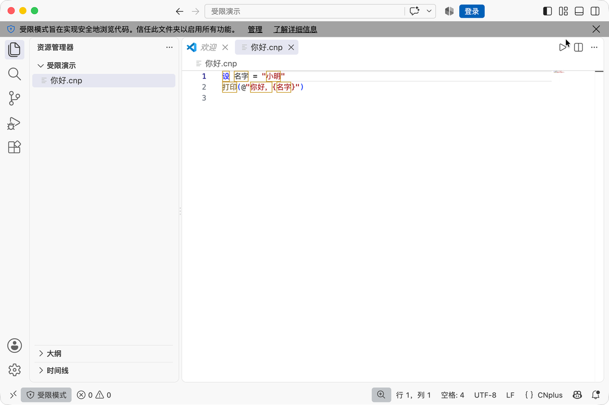
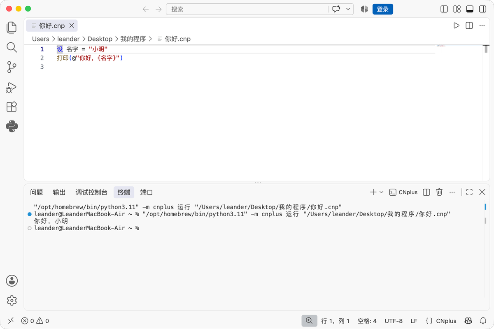

# 开始

> 欢迎来到 CNplus！这一篇是序言——先认识它、挑一条路开始写代码，然后进入第一课。

## 你好，CNplus

CNplus 是一门**中文编程语言**：关键字、类型、报错全是中文。写程序不用先「翻译」一遍英文，直接顺着中文说：

```cnp
设 名字 = "小明"
打印(@"你好，{名字}")
```

跑起来，屏幕输出 `你好，小明`。

## 它是怎么来的

CNplus 始于 **2021 年 12 月**，最初只是一层中文函数名封装；**2022 年 6 月**想用 C++ 重做成 IDLE，停在一个没写完的 `cout` 上。**2026 年重启**，这次不急着堆功能，先搭好「源码 → 抽象语法树」和「语法树 → 执行」之间的接缝，再往上盖楼。所以它有自己的词法器、语法分析器和抽象语法树，执行后端可插拔。

## 它哪里不一样

- 🌏 **全中文**：关键字、类型名、报错、诊断码全是中文
- 💬 **三层报错**：术语 + 大白话 + 能直接照抄的改法
- 🗣️ **一意多写**：`设`＝`令`＝`让`，用你顺口的那个
- 🧱 **严格语义**：新手最常踩的坑被当场堵死（`如果 0` 直接报错，不让你懵）

后面每一章会逐个展开。

## 先选一条开始路线

代码本身完全相同，只是准备环境的方式不同：

| 路线 | 适合谁 | 怎么开始 |
|---|---|---|
| 🖥️ [VSCode + 本地 `.venv`](#用-vscode-写) | 想认真学、长期写 | **最推荐**：有高亮、实时诊断、补全、悬停、跳转定义和一键运行 |
| 🌐 [网页立即体验](#在网页上写) | 只想先试试、不安装 | **最快**：打开网页就能写 |

已经装好环境、只想从终端运行文件？跳到[命令行首跑](#用命令行跑)。完整命令和后端边界统一查[运行程序的几种方式](../参考/运行程序的几种方式.md)。

---

## 用 VSCode 写

日常写代码就选它，装一次、一直用。全程约 10 分钟，不需要任何编程基础。

### 第 0 步：准备 Python 3.11 或更高版本

CNplus 跑在 Python 上。先打开终端：

- **Windows**：开始菜单搜索“PowerShell”
- **macOS**：按 `⌘ + 空格`，搜索“终端”
- **Linux**：从应用列表打开“终端”

检查版本：

**macOS / Linux**

```bash
python3 --version
```

**Windows PowerShell**

```powershell
py -3 --version
```

看到 `Python 3.11` 或更高版本就可以继续。版本较低或找不到命令时，从 [python.org](https://www.python.org/downloads/) 安装当前受支持的 Python 3；Windows 安装时勾选 **Add Python to PATH**。

### 第 1 步：下载 CNplus，建立项目内 `.venv`

下面的 `/tmp` 和 `$env:TEMP` 是不带个人信息的示例位置；系统可能定期清理临时目录，正式学习时可以换成你自己的项目文件夹。

**macOS / Linux**

```bash
cd /tmp
git clone https://github.com/CNplus/CNplus-lang.git
cd CNplus-lang
python3 -m venv .venv
source .venv/bin/activate
python -m pip install -e ".[lsp]"
```

**Windows PowerShell**

```powershell
cd $env:TEMP
git clone https://github.com/CNplus/CNplus-lang.git
cd CNplus-lang
py -3 -m venv .venv
.\.venv\Scripts\Activate.ps1
python -m pip install -e ".[lsp]"
```

每行输完按回车，等它执行完再输入下一行。命令开头出现 `(.venv)`，说明虚拟环境已经启用；以后新开终端进入这个项目时，要再运行对应的 `activate` 命令。

> Windows 如果提示“禁止运行脚本”，不用修改系统安全策略：改用 `.\.venv\Scripts\python.exe -m pip install -e ".[lsp]"` 安装，之后用 `.\.venv\Scripts\cnp.exe` 代替 `cnp` 即可。

> 没有 Git？可以在 [CNplus-lang 仓库](https://github.com/CNplus/CNplus-lang) 点 **Code → Download ZIP**，解压后进入该文件夹，再从创建 `.venv` 的命令继续。

### 第 2 步：先跑通一个示例

虚拟环境保持启用，然后运行：

```bash
cnp 版本
cnp 运行 示例/01-你好.cnp
```

依次看到当前 CNplus 版本和 `你好，世界！`，说明本体装好了。以上安装路径已用全新 `.venv` 实测。

### 第 3 步：安装 VSCode 扩展

1. 还没有 VSCode：从 [VSCode 官网](https://code.visualstudio.com/) 下载适合 Windows、macOS 或 Linux 的版本并安装。
2. 从 [GitHub Release](https://github.com/CNplus/CNplus-lang/releases) 下载最新的 `cnplus-<版本>.vsix`。
3. 在 VSCode 里按 `Ctrl + Shift + X`；macOS 也可以按 `⌘ + ⇧ + X`。点扩展面板右上角 `…` → “从 VSIX 安装…”，选择下载的文件。
4. 完全退出 VSCode 后重新打开，让扩展加载。

装好后，“已安装”列表会出现 **CNplus**。它提供语法高亮、实时中文诊断、补全、悬停、跳转定义和 F5 运行。

### 第 4 步：打开项目并信任工作区

用“文件 → 打开文件夹”打开刚才克隆或解压的 `CNplus-lang` **整个文件夹**。项目根目录里有 `.venv`，扩展会优先找到它。

VSCode 出于安全可能进入“受限模式”，此时扩展不会运行。看窗口左下角：



如果显示“受限模式”，点击它并选择“信任”；若提示重新加载窗口，再点一次重新加载。只信任你自己下载并确认来源的代码。

### 第 5 步：写第一个本地程序

1. 在左侧文件列表中新建文件夹 `我的程序`。
2. 在里面新建 `你好.cnp`；扩展名必须是 `.cnp`，不是 `.txt`。
3. 写入：

```cnp
设 名字 = "小明"
打印(@"你好，{名字}")
```

代码会自动上色，编辑器右上角出现 ▶：



按 **F5**（部分 Mac 键盘要按 `fn + F5`），或直接点击 ▶。下方终端应输出：

```text
你好，小明
```

看到这行字，就可以进入[第一课：变量与类型](01-起步/01-变量与类型/01-教程.md)。

### 排查：扩展用了哪个 Python

扩展按这个顺序寻找能导入 CNplus 的解释器：你在设置里明确指定的路径 → 工作区 `.venv/bin/python`（Windows 是 `.venv\Scripts\python.exe`；macOS / Linux 也检查 `venv/bin/python`）→ 常见系统安装位置 → `PATH` 里的 Python。

如果 F5 报“找不到解释器”，先确认你打开的是包含 `.venv` 的 `CNplus-lang` 文件夹，并在 VSCode 命令面板运行 **CNplus: 显示当前使用的解释器**。仍不正确时，可以在设置中填写 `cnplus.python路径`，指向：

- macOS / Linux：项目里的 `.venv/bin/python`
- Windows：项目里的 `.venv\Scripts\python.exe`

---

## 在网页上写

最简单，零安装。打开 [cnplus.org/playground](https://cnplus.org/playground)，浏览器里直接写代码、直接跑，**什么都不用装**，还支持把代码生成分享链接（URL 里带代码）。

**适合**：想先试试 CNplus、又不想折腾环境的。

**局限（扩展性不足）**：不能安装本地插件，也不能像本地程序一样自由读写电脑文件；可以生成分享链接，但不适合长期管理多个程序。认真学下去时，建议回到[用 VSCode 写](#用-vscode-写)。

---

## 用命令行跑

适合已经按上面步骤装好环境、想快速运行文件的人。先进入项目并启用 `.venv`，再执行：

```bash
cnp 运行 我的程序/你好.cnp
```

开始页只需要记住这一条。树遍历、Python、JS、编译、交互模式和检查命令全部集中在[运行程序的几种方式](../参考/运行程序的几种方式.md)，需要时再查。

---

准备好了就开始第一课：

**接下来：[变量与类型](01-起步/01-变量与类型/01-教程.md)**
